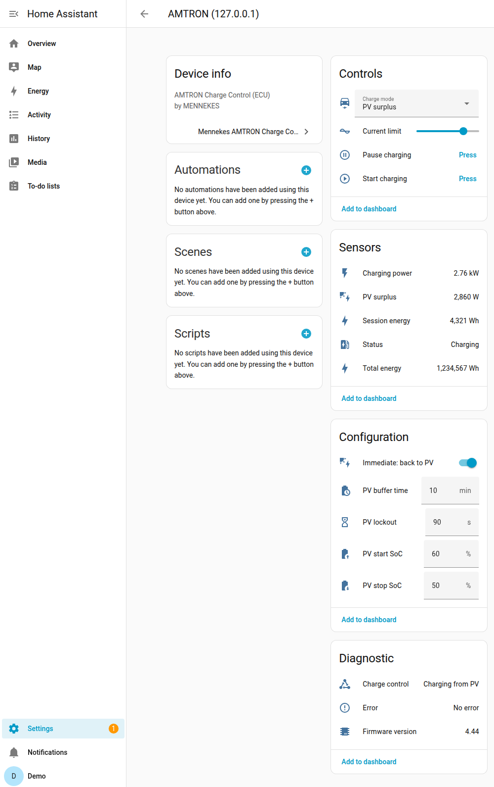
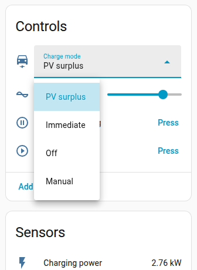
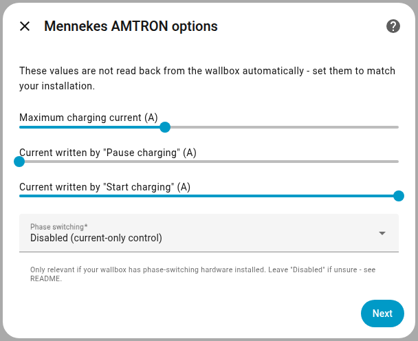
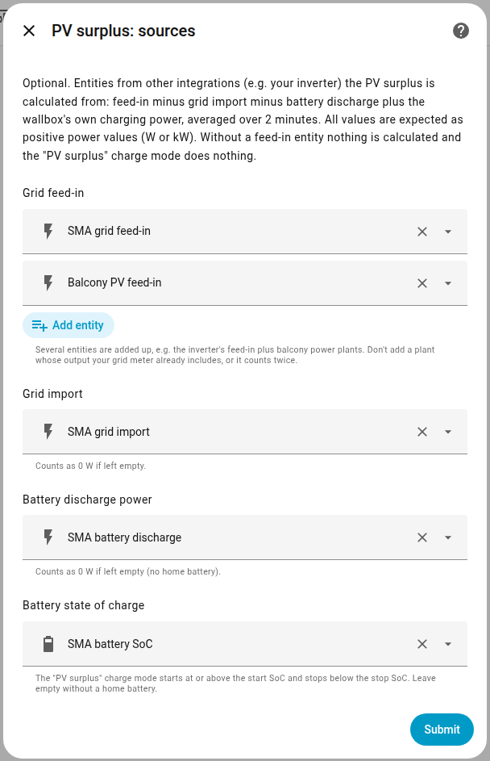
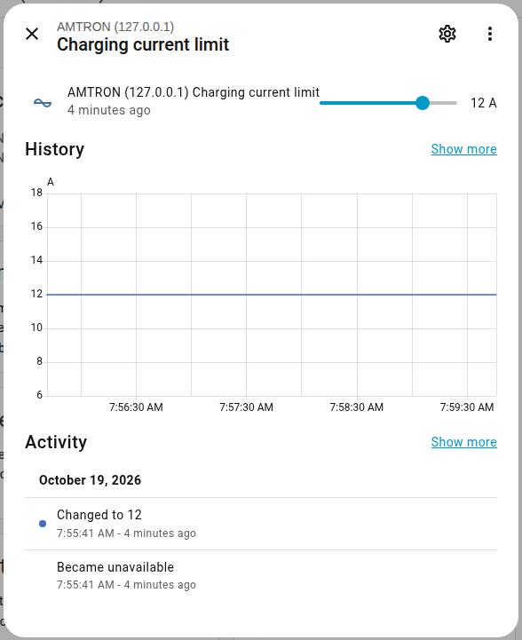
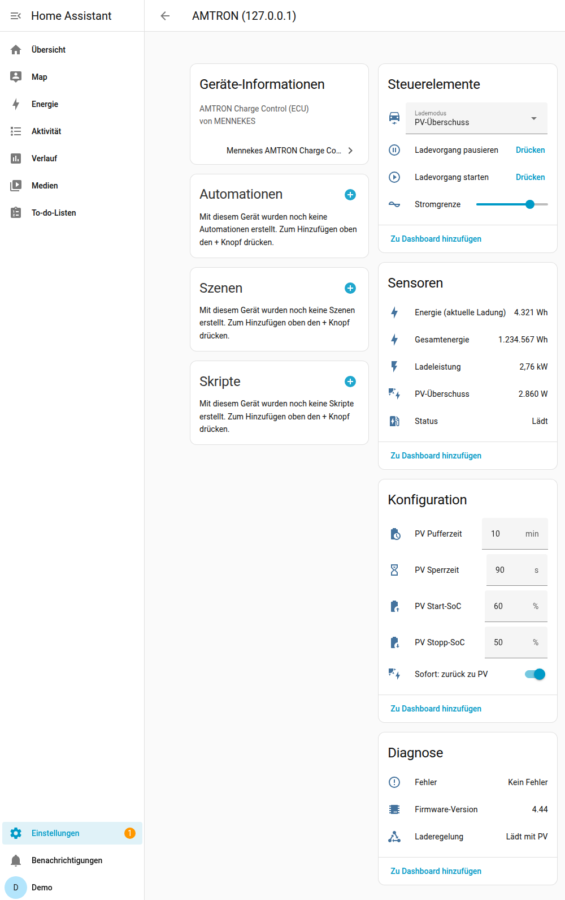
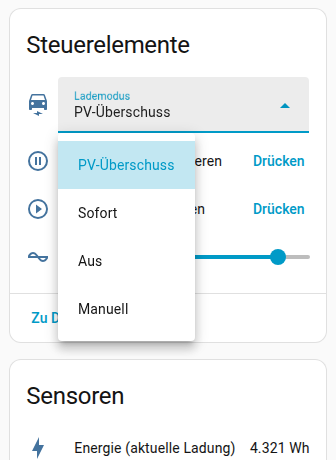
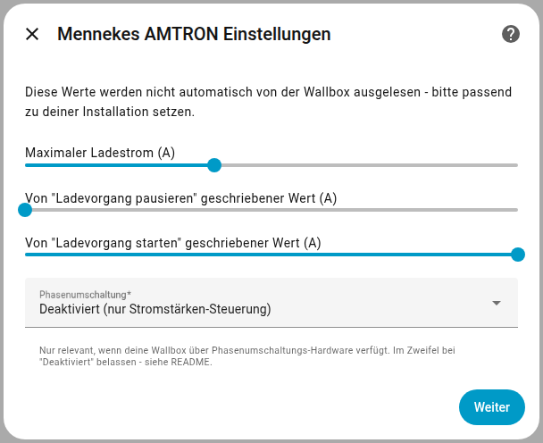
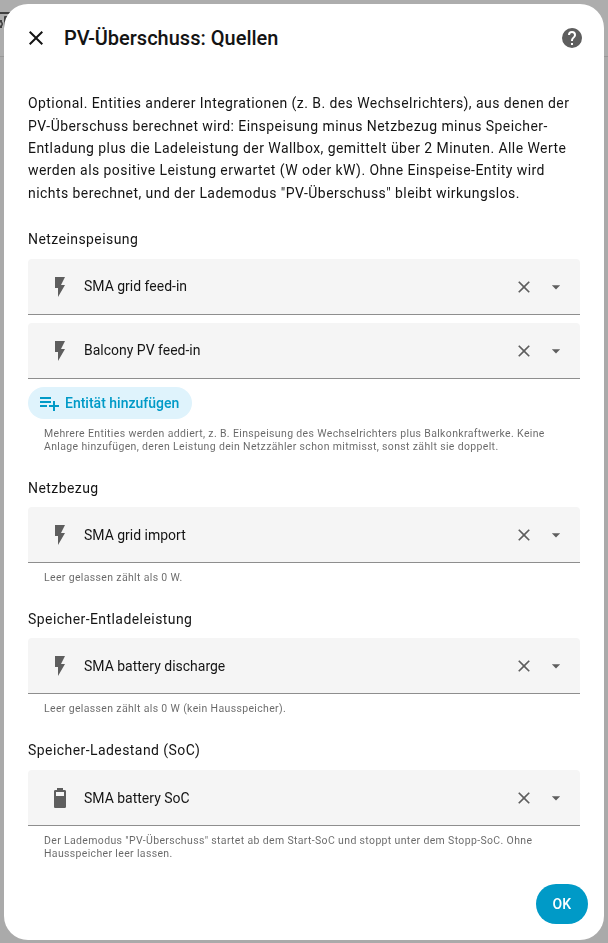
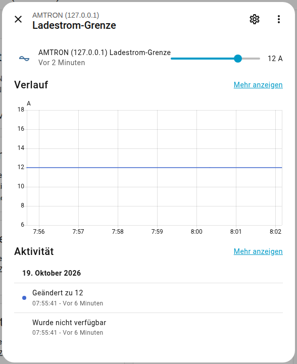

# Mennekes AMTRON Charge Control – Home Assistant Integration

[](https://github.com/TenOfNine/Mennekes-HA-Integration/actions/workflows/ci.yml)
[](https://github.com/TenOfNine/Mennekes-HA-Integration/actions/workflows/hassfest.yaml)


[](https://github.com/hacs/integration)

Custom [Home Assistant](https://www.home-assistant.io/) integration for a **Mennekes AMTRON
Charge Control** wallbox (ECU controller) over local **Modbus TCP** — no cloud, no app, no
pymodbus dependency.

> Built for the ECU controller family (AMTRON Charge Control, AMTRON Professional, AMEDIO
> Professional). AMTRON Xtra/Premium use a different controller (HCC3) with a different
> register map and word order — not compatible with this integration.

🇩🇪 **Deutsche Kurzanleitung** (Einrichten, Einstellungen, Lademodi): [ANLEITUNG.md](ANLEITUNG.md)

## Features

- **Charging power** (kW) — live, from the wallbox's built-in energy meter
- **Current limit** (A) — adjustable, with a configurable maximum matching your
  supply circuit's fusing
- **Start charging** — sets a configurable "start current" (16 A by default), then writes a
  synthetic OCPP IdTag (same effect as tapping an RFID card). If a session is already open, it
  only sets the current.
- **Pause charging** — writes a configurable "pause current" (0 A by default, per the
  manufacturer's documented pause mechanism)
- **Status**, **session energy**, **total (lifetime) energy**, **system errors**, and
  **firmware version** as additional sensors
- All three configurable currents (max., start, pause) are changeable at runtime via
  **Settings → Devices & Services → Mennekes AMTRON → Configure** — no file edits, no restart.
  The start current is bounded between 6 A and the configured maximum current.
- **Charge mode** select: PV surplus, Immediate, Off or Manual — see
  [PV surplus charging](#pv-surplus-charging).
- Optional **PV surplus charging** with home-battery priority, from your inverter's entities.
- Optional **1-phase/3-phase switching** — see below.

## Entities

| Entity | Type | Shown under | Notes |
|---|---|---|---|
| Charge mode | Select | Controls | PV surplus / Immediate / Off / Manual. Default Manual. |
| Current limit | Number (A) | Controls | 0 = paused; 6 A … configured maximum. Changing it switches the charge mode to Manual. |
| Power limit | Number (W) | Controls | Only with phase switching enabled. |
| Start charging / Pause charging | Button | Controls | Both switch the charge mode to Manual. |
| Charging power | Sensor (kW) | Sensors | From the wallbox's meter. |
| Status | Sensor | Sensors | OCPP status, e.g. Available, Charging, Suspended (wallbox), Suspended (vehicle). |
| Session energy / Total energy | Sensor (Wh) | Sensors | Total energy works with the Energy dashboard. |
| PV surplus | Sensor (W) | Sensors | Only with PV sources configured; 2-minute average. |
| PV start SoC, PV stop SoC, PV lockout, PV buffer time | Number | Configuration | Only with PV sources configured; see [PV surplus controller](#pv-surplus-controller). |
| Immediate: back to PV | Switch | Configuration | Only with PV sources configured; see [Back from Immediate](#charge-mode). |
| Charge control | Sensor | Diagnostic | What the PV controller is doing and why. |
| Error | Sensor | Diagnostic | "No error", the active error in plain words, or "Several errors"; the attributes list every active error. |
| Firmware version | Sensor | Diagnostic | |

## Getting started

1. Prepare the wallbox ([Wallbox setup](#wallbox-setup)), then [install](#installation) and add
   the integration with the wallbox's IP address.
2. **Configure**, page 1: set the maximum current to match your supply circuit; adjust the start
   and pause currents if needed. Leave phase switching on "Disabled" unless your unit has the
   hardware (and for PV surplus charging).
3. Optional, **Configure**, page 2: pick your inverter's feed-in, grid import, battery discharge
   and battery SoC entities to enable PV surplus charging ([Sources](#sources)).
4. Pick a **Charge mode** on the device page. Without PV sources, use Manual and the Start/Pause
   buttons, or Immediate/Off.
5. With PV sources: adjust the PV thresholds under **Configuration** on the device page and watch
   the **Charge control** sensor to see what the controller decides.

## Phase switching (1-phase / 3-phase)

Off by default. If your unit has phase-switching hardware installed (a relay that can
disconnect L2/L3), you can enable it in **Configure** under **"Phasenumschaltung" / "Phase
switching"**:

| Mode | Effect |
|---|---|
| Disabled *(default)* | Unchanged from above: only the Amp-based **Current limit** entity exists. |
| Single-phase only | Adds a **Power limit** (W) entity; requests are always clamped to the 1-phase range, never switching to 3-phase. The charge mode controller (PV surplus, Immediate, Off) is inactive in this mode and the next. |
| Automatic (1-phase / 3-phase) | Adds the same **Power limit** (W) entity; the wallbox switches phases itself depending on the requested power - below 4140 W it charges 1-phase, at or above it charges 3-phase (the wallbox's own documented behavior for this register, not something this integration decides). |

Set the entity to the power you actually want delivered (e.g. `1380` for a minimal 1-phase
charge, `11040` for a full 3-phase 16 A charge); the integration converts it to what the wallbox
expects and enforces the IEC 61851 minimum of 6 A per phase - anything that would fall below
that on the selected phase count is written as `0` (paused) instead, matching the register's own
documented meaning for that value.

**This is separate from, and independent of, the plain Amp-based current control above** - the
two use different registers (`HEMS_CURRENT_LIMIT` vs `HEMS_POWER_LIMIT`) and are not meant to be
used at the same time. Unlike `HEMS_CURRENT_LIMIT`, `HEMS_POWER_LIMIT` has **not been directly
confirmed against physical hardware by this project** - it's cross-referenced from the same ECU
Modbus TCP Server Specification via secondary sources (community reports for AMTRON/ECU-family
devices) rather than the primary manufacturer PDF. Only enable a non-default mode if your
installation actually has the phase-switching relay, and verify behavior carefully against your
own unit before relying on it.

## PV surplus charging

Charges the car from PV surplus, with the home battery taking priority. Configured in two places:
the source entities on the second page of **Configure**, and the charge mode plus thresholds as
entities on the device page.

### Sources

| Field | Notes |
|---|---|
| Grid feed-in | One or more; they are added up (e.g. inverter feed-in plus balcony power plants). Don't add a plant your grid meter already measures, or it counts twice. |
| Grid import | Optional, 0 W if empty. |
| Battery discharge power | Optional, 0 W if empty (no home battery). |
| Battery state of charge | Optional. Leave empty without a home battery; the SoC thresholds are then ignored. |

All values are expected as positive power values in W, kW or MW (a sensor without a unit is read
as W). With at least one feed-in entity configured, a **PV surplus** (W) sensor appears:

`feed-in − grid import − battery discharge + wallbox charging power`, sampled every 10 s and
averaged over the last 2 minutes, which rides out short shading. The wallbox's own charging power
is added to each sample *before* averaging: added afterwards, the average would still show the
old surplus for up to 2 minutes after every current change, and the controller would overshoot.
Battery *charging* is not added back, so the home battery keeps priority over the car. If any
source (or the wallbox) is unavailable, that sample is skipped rather than counted as 0 W; the
sensor's attributes show the last sample's individual values.

### Charge mode

The **Charge mode** select entity:

| Mode | Effect |
|---|---|
| PV surplus | The controller below starts, stops and sets the current. |
| Immediate | Charges at the configured maximum current; optionally back to PV surplus once the car is full (below). |
| Off | Holds the current at 0 A. |
| Manual *(default)* | The integration doesn't touch the wallbox on its own. |

**Manual override:** pressing **Start charging** or **Pause charging**, or changing the
**Current limit**, switches the mode to Manual - otherwise the controller would undo it
within 30 s. The controller's own starts and stops don't. Unplugging the car (status "Available"
for 10 s) switches Manual back to PV surplus if PV sources are configured; Immediate and Off
stay until you change them.

**Back from Immediate:** with *Immediate: back to PV* on (the default), Immediate
switches to PV surplus once the car is full. The wallbox doesn't know the car's state of charge,
so "full" means the car has paused charging itself (status "Suspended (vehicle)") for 10 minutes
while current was offered. A car that pauses on its own for other reasons (e.g. its own charging
timer) counts as full too; turn the switch off then. PV surplus then takes over the session as at
plug-in: it keeps it if the start condition holds and stops it otherwise.

### PV surplus controller

Runs every 30 s. It assumes the car charges on **one phase**, so each Amp is worth 230 W.

- **Start** when the battery SoC is at or above *PV start SoC* (default 60 %) **and** the
  2-minute average is at least 1380 W (6 A).
- **Current** = floor(average / 230 W), limited to 6 A … the configured maximum; written only when
  it changes.
- **Below 6 A** of surplus it keeps charging at 6 A from the battery for *PV buffer time*
  (default 10 min) to bridge clouds, then stops. The battery only buffers; it isn't drained into
  the car.
- **Stop** when the SoC falls below *PV stop SoC* (default 50 %); it restarts only once the start
  SoC is reached again. The gap is the hysteresis, so the stop SoC must stay below the start SoC.
- At least *PV lockout* (default 90 s) between two start or stop commands. Picking a mode
  yourself acts at once.
- If the wallbox starts charging on its own (e.g. at plug-in), the controller takes the session
  over if the start condition holds and stops it otherwise - the start SoC applies to every
  session.
- If the wallbox status, the surplus average (needs at least 1 minute of samples) or the SoC is
  unavailable, it does nothing and the last current stays.

The **Charge control** diagnostic sensor shows what the controller is doing and why (e.g.
"Waiting for battery SoC", "Buffering from battery"), with the target current as an attribute.
The controller only works with **phase switching disabled**, since it controls the current
register, not the power register.

Stopping means writing 0 A: the wallbox has no Modbus command to end a session, so the session
stays open and a restart only raises the current again.

## Screenshots

The device page in Home Assistant with PV sources configured, showing every entity the
integration provides. The values are from a demo setup charging one phase at 12 A from 2860 W of
PV surplus:



The **Charge mode** select:



The **Configure** dialog (Settings → Devices & Services → Mennekes AMTRON → Configure). Page 1
sets the currents and phase switching:



Page 2 picks the PV surplus sources:



The current limit entity's own dialog, with its history graph:



<details>
<summary>Same screenshots in German (Home Assistant UI set to Deutsch)</summary>







</details>

## Why no pymodbus?

This integration ships a minimal, dependency-free Modbus TCP client
(`modbus_client.py`, plain `asyncio` + `struct`). Two reasons:

1. Mennekes' Modbus TCP servers document a single simultaneous connection and no keepalive
   support — a short-lived connection per request is the robust approach here, not a
   workaround.
2. Home Assistant's built-in `modbus` integration pins its own pymodbus version. A
   custom_component pinning a *different* version is a well-known source of dependency
   resolution failures for anyone who also uses core Modbus. Not declaring the dependency at
   all avoids that failure mode entirely.

## Requirements

- AMTRON Charge Control (or Professional / AMEDIO Professional) with **firmware ≥ 5.12.x**
  (baseline for the Modbus TCP interface). Some registers this integration uses were
  cross-checked against community reports recommending **≥ 5.22**; if setup fails outright,
  updating firmware is a reasonable first step (mennekes.de → eMobility → Services →
  Software-Updates).
- Wallbox and Home Assistant on the same network.
- Modbus TCP **and** the "kostenloses Laden" (free charging) authorization exception enabled
  on the wallbox — see [Wallbox setup](#wallbox-setup) below.

## Wallbox setup

1. Log into the wallbox's web interface as **Operator**.
2. **Lastmanagement** → set **Modbus TCP** to on.
3. Set the **Modbus register set** to **"Mennekes"** (see [Troubleshooting](#troubleshooting)
   if this doesn't work).
4. Still under **Lastmanagement**, enable **"Modbus Slave Allow Start/Stop Transaction"**.
5. **Authorisierung** → set **"kostenloses Laden"** to on. Without this, the start command
   this integration sends is rejected like an unrecognised RFID card, since it isn't on any
   whitelist.
6. Save and reboot the wallbox.

Modbus TCP is then reachable on **port 502**, unit ID **255**.

## Installation

### HACS (custom repository)

1. HACS → the **⋮** menu (top right) → **Custom repositories**
2. Add this repository's URL, category **Integration**
3. Search for **"Mennekes AMTRON Charge Control"** in HACS and install
4. Restart Home Assistant

### Manual

1. Copy `custom_components/mennekes_amtron/` into `<config>/custom_components/`
2. Restart Home Assistant

### Both methods, then

**Settings → Devices & Services → Add Integration** → search for **"Mennekes AMTRON"** →
enter the wallbox's IP address (port `502` and unit ID `255` are pre-filled).

Setup performs a real Modbus read against the wallbox immediately, so a misconfiguration
shows up as an error in the dialog rather than a silent, non-functional "success".

## Troubleshooting

The setup dialog shows the actual Modbus error text (e.g. `Illegal function`,
`Illegal data address`) rather than a generic message — this alone usually narrows the cause
down immediately.

| Symptom | Likely cause |
|---|---|
| `Illegal function` | The wallbox only accepts **function code 3** (Read Holding Registers) for these registers, not function code 4 — despite the manufacturer's document labelling them "READ". This integration always uses function code 3; confirmed against community reports for the Charge Control specifically. |
| Persistent Modbus errors regardless of function code | Register set may be set to an alternative like `TQDM100` instead of `Mennekes` in the wallbox UI — see [Wallbox setup](#wallbox-setup), step 3. |
| Connects, but `Illegal data address`, or unit ID issues | Default unit ID is 255 (most common), but at least one report used **unit ID 1** instead. Try 1 if 255 fails. |
| `start_charging` has no effect | Confirm both "Modbus Slave Allow Start/Stop Transaction" and "kostenloses Laden" are enabled (steps 4–5 above). |
| Charge mode switches to Manual by itself | Intended: pressing Start/Pause or changing the current limit is a manual override. Unplugging the car switches back to PV surplus. |
| Charge control: "No PV sources configured" | PV surplus is selected, but no feed-in entity is set on page 2 of **Configure**. |
| Charge control: "Waiting for data" | A source entity, the battery SoC or the wallbox is unavailable, or the integration started less than a minute ago. The last current stays. |
| Charge control: "Phase switching enabled" | Set phase switching to "Disabled"; the controller only works with the current register. |
| PV surplus doesn't start charging | Check the **Charge control** sensor: it starts only at or above the start SoC **and** with at least 1380 W of surplus in the 2-minute average. Compare the **PV surplus** sensor's attributes with your inverter's app. |

## Development

```bash
pip install -r requirements-dev.txt
ruff check .
pytest tests/ -v
```

Tests run against a fake Modbus TCP server and a small local stand-in for `homeassistant`
(see [`tests/stubs/README.md`](tests/stubs/README.md) for why) — no real Home Assistant
install needed to run them. `hassfest` (manifest/translation schema) runs in CI on every push.

## Register map source

- MENNEKES: *"ECU-BRx and ECU-BBx Modbus TCP Server Specification"*, Doc. Revision 1.07 — the
  official protocol document for AMEDIO Professional, AMTRON Professional, and AMTRON Charge
  Control.
- Setup steps and known pitfalls cross-checked against a community integration guide
  (nymea.energy) and a forum thread on Modbus TCP access to the Charge Control (SPS-Forum).

## License

[MIT](LICENSE) — do what you like with it; no warranty.

## Contributing

Issues and pull requests welcome. This is a small, single-purpose integration for one
wallbox family — if you're adding support for a different Mennekes controller (e.g. the
HCC3-based Xtra/Premium), a separate integration is probably cleaner than branching this one.
